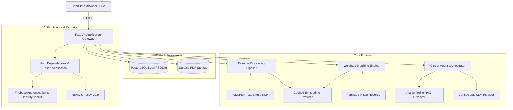

# CareerMatch AI — Architecture Specification

This document details the architectural design and system workflows implemented in CareerMatch AI.

---

## 1. Authentication & Session Architecture

- **Dual-Mode Client Auth**: The frontend SPA supports direct Google Sign-In popups and Email/Password registration powered by Firebase Web SDK v10.13.2.
- **Verification Gating**: Candidates registered via email/password are restricted by `require_verified_user` until their email is confirmed. Google accounts bypass this check because Google already verifies email ownership.
- **Identity Toolkit Integration**: The backend service communicates directly with Google Identity Toolkit REST endpoints (`accounts:sendOobCode`, `accounts:signInWithPassword`, `accounts:signUp`) using client API keys and OAuth2 service account assertions.
- **Internal Session JWTs**: Upon validating a Firebase ID token, the backend issues an internal cryptographic JWT (`HS256`) containing candidate ownership claims (`sub`, `email`, `role`, `email_verified`).

---

## 2. Storage & Persistence Architecture

- **PostgreSQL (Neon Serverless)**:
  - Connection pooling via `asyncpg` with zero statement caching (compatible with PgBouncer / Neon connection pooling).
  - Schema tables: `users`, `candidate_profiles`, `resumes`, `jobs`, `user_saved_jobs`, `match_records`, `scraping_runs`, `scraping_sources`, `scraping_locks`.
  - SQLite fallback is supported transparently for local zero-network testing.
- **Durable PDF Storage**:
  - Resumes are validated for magic byte signatures (`%PDF-`), hashed with SHA-256, and stored in `storage/resumes/{user_id}/{sha256}.pdf`.
  - Content hashing ensures identical resumes are deduplicated and avoid redundant re-parsing.

---

## 3. Resume Versioning & Processing Pipeline

1. **Upload & Validation**: Enforces MIME validation, 5MB file limits, and checks for executable payloads (`MZ`, `ELF`).
2. **PyMuPDF Extraction**: Extracts text, contact info, skills, education, and experience chronologies deterministically.
3. **Active Version Management**:
   - Marking a new resume as `active` updates the candidate's active profile in PostgreSQL.
   - Previous match scores tied to prior resume versions are invalidated, preventing stale scores from polluting the dashboard.
   - Saved job relationships are independent of resume versions and remain preserved.

---

## 4. Job Ingestion & Discovery

- **Source Adapters**: Dedicated ATS parsers for Greenhouse, Lever, and Ashby.
- **SSRF Defense**: Enforces domain allowlists (`APPROVED_JOB_DOMAINS`) and blocks internal IP ranges (`10.0.0.0/8`, `127.0.0.0/8`, `192.168.0.0/16`, AWS metadata `169.254.169.254`).
- **Deduplication**: Jobs are normalized and deduplicated via unique compound keys (`source_platform`, `external_job_id`) and SHA-256 content hashes.

---

## 5. Multi-Factor Matching Engine

The matching engine uses a deterministic, transparent scoring formula with no hidden LLM cost per job:

$$\text{Overall Score} = 0.40 \cdot \text{Skill Score} + 0.25 \cdot \text{Experience Score} + 0.15 \cdot \text{Domain Score} + 0.20 \cdot \text{Semantic Score}$$

- **Skill Match (40%)**: Jaccard similarity between candidate extracted skills and job requirements.
- **Experience Match (25%)**: Ratio of candidate experience years to job requirements.
- **Domain Match (15%)**: Alignment of candidate industry focus with job taxonomy.
- **Semantic Match (20%)**: Cosine similarity between candidate embedding and job requirement embedding.
- **Caching**: The `CachedEmbeddingProvider` ensures embeddings for candidate profiles and job descriptions are cached in-memory and in PostgreSQL, achieving sub-15ms match queries on dashboard load.

---

## 6. Career Advisory Agent & RAG

- **Tool-Restricted Policy Gate**: The Career Agent only has access to application-specific, sandboxed tools (`get_candidate_profile`, `get_match_explanation`, `search_jobs`, `suggest_resume_improvements`).
- **Grounded Profile Retrieval**: The agent retrieves the active candidate profile automatically from the verified JWT principal without asking the user to re-upload their resume.
- **Prompt Injection Defense**: All resume chunks, job descriptions, and user inputs are strictly encapsulated in data blocks to prevent prompt hijacking.

