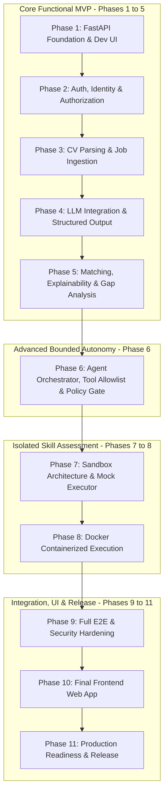
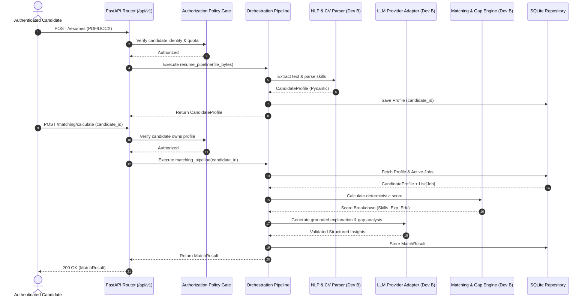
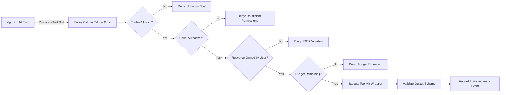
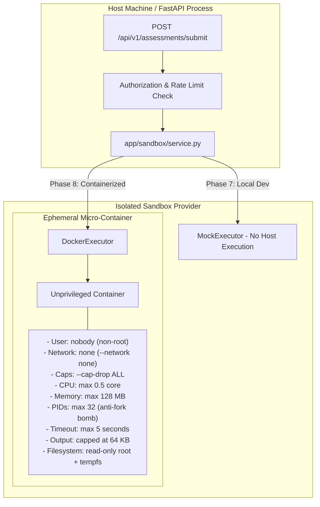

# Phase 0 Architecture & Audit Report: AI Job Matcher

**Date:** October 12, 2026  
**Status:** Phase 0 Complete — Awaiting Developer Approval  
**Project Owner / Dev A:** User  
**Dev A & Dev B Lead Implementer:** Antigravity  
**GitHub Remote Target:** `https://github.com/mayankg9232-hue/ai-job-matching.git`  

---

## 1. Executive Summary & Repository Baseline (Audit Checks)

A comprehensive baseline inspection of the repository `/Users/lakshayjaiswal/ai-job-matcher` was performed in strict accordance with [AGENTS.md](file:///Users/lakshayjaiswal/ai-job-matcher/AGENTS.md), [AI_Job_Matcher_Phases_and_Structure.md](file:///Users/lakshayjaiswal/ai-job-matcher/docs/AI_Job_Matcher_Phases_and_Structure.md), and [AI_Agent_Rulebook.md](file:///Users/lakshayjaiswal/ai-job-matcher/docs/AI_Agent_Rulebook.md).

No application code was altered, no packages were installed, and no external deployments were triggered during this audit.

### Five Mandatory Phase 0 Audit Checks

| Audit Check | Scope & Inspection Details | Actual Observed Result |
| :--- | :--- | :--- |
| **1. Repository Tree & Entry Point** | Workspace root scanned for directory layout, files, and application entry point. | Workspace contains `.DS_Store`, `AGENTS.md`, and `docs/` (`AI_Job_Matcher_Phases_and_Structure.md`, `AI_Agent_Rulebook.md`). **No `.git` directory exists locally.** No entry point (`app/main.py`) exists yet. |
| **2. Dependency & Environment Setup** | Host inspected for Python runtimes, Homebrew, and package managers. | Python 3.14.3 located at `/Library/Frameworks/Python.framework/Versions/3.14/bin/python3`. **Python 3.11 located at `/opt/homebrew/bin/python3.11`**. No virtual environment (`.venv`) or `requirements.txt` exists yet. |
| **3. Existing Tests & Test Command** | Workspace searched for test suites and test runner binaries. | No `tests/` directory exists. `pytest` is not present in global host path. Standard test runner will be `pytest` inside a dedicated Python 3.11 virtual environment. |
| **4. Secrets & Ignored Files** | Workspace scanned for `.env`, credentials, API tokens, and `.gitignore`. | **No `.env` or hardcoded credentials detected.** Neither `.gitignore` nor `.env.example` exists yet; both must be established immediately upon Phase 1 initialization. |
| **5. Ownership & Contract Gaps** | Interfaces and ownership boundaries between Developer A and Developer B analyzed. | Clear ownership established in documentation, but zero Pydantic contracts or interface definitions exist in code. Initial Pydantic schemas must be established before dependent services are built. |

> [!IMPORTANT]
> **Host Environment Finding**: Python 3.14 is preview/experimental and lacks precompiled wheels for core ML/data libraries (`spacy`, `pydantic-core`, `tiktoken`, `chromadb`). Python 3.11 (`/opt/homebrew/bin/python3.11`) is installed and must be used as the project virtual environment runtime. Docker is currently not present in host `PATH`.

---

## 2. What Already Exists vs. What Needs to Be Built

### What Already Exists
1. **Core Governing Documentation:**
   - [`AGENTS.md`](file:///Users/lakshayjaiswal/ai-job-matcher/AGENTS.md): Defines foundational rules, testing requirements (>=5 distinct tests per phase), two-developer responsibilities, security rules, and completion reporting.
   - [`docs/AI_Job_Matcher_Phases_and_Structure.md`](file:///Users/lakshayjaiswal/ai-job-matcher/docs/AI_Job_Matcher_Phases_and_Structure.md): Complete phase-gated master plan (Phases 0 through 11).
   - [`docs/AI_Agent_Rulebook.md`](file:///Users/lakshayjaiswal/ai-job-matcher/docs/AI_Agent_Rulebook.md): Non-negotiable agent execution boundaries, tool allowlisting, state machines, and code-execution sandbox rules.
2. **System Environment:**
   - macOS host with Git 2.54.0 and Python 3.11.

### What Needs to Be Built
1. **Repository & Tooling Foundation (Phase 1):**
   - Git initialization linked to `https://github.com/mayankg9232-hue/ai-job-matching.git`.
   - `.gitignore` (ignoring `.env`, `.venv`, `__pycache__`, sandbox artifacts).
   - `.env.example` (clean placeholders).
   - `requirements.txt` and `requirements-dev.txt`.
   - Python 3.11 virtual environment.
2. **Application Core & Backend Infrastructure (Developer A):**
   - FastAPI app startup, logging configuration, custom exception handlers, and security middleware in `app/core/`.
   - Versioned API routing (`/api/v1`) with endpoints for health, auth, resumes, jobs, matching, assessments in `app/api/v1/`.
   - Authorization policies and resource-ownership enforcement in `app/authorization/`.
   - Pipeline orchestrators (`resume_pipeline.py`, `job_ingestion_pipeline.py`, `matching_pipeline.py`) in `app/pipelines/`.
   - Agent orchestrator, tool registry, policy gate, budgets, guardrails, and audit logging in `app/agents/`.
   - Code execution sandbox interface, limit enforcement, and execution providers in `app/sandbox/`.
3. **Data, AI & Extraction Capabilities (Developer B):**
   - Authentication service (JWT / password hashing / user identity) in `app/authentication/`.
   - Resume parser, skill extractor, and entity normalizer in `app/nlp/`.
   - Dual LLM provider adapters (Primary + Secondary fallback) in `app/integrations/llm/`.
   - Firecrawl client and source adapters in `app/integrations/firecrawl/`.
   - Embeddings, vector retrieval, and RAG service in `app/retrieval/`.
   - Explainable matching engine, scoring algorithm, and skill-gap analyzer in `app/matching/`.
4. **Data Contracts & Persistence:**
   - Typed Pydantic schemas in `app/schemas/`.
   - SQLite-backed repository abstractions in `app/repositories/`.
5. **Testing & Developer Interfaces:**
   - Lightweight testing UI in `dev_ui/` (HTML/CSS/JS) for early manual verification.
   - Test suites in `tests/` (unit, integration, security, agents, sandbox, fixtures).
   - Future production frontend in `frontend/` (Phase 10) and production deployment configs in `Dockerfile` / `docker-compose.yml` (Phase 11).

---

## 3. Recommended File Structure & Module Ownership

The proposed directory layout maps cleanly to `docs/AI_Job_Matcher_Phases_and_Structure.md`:

```text
ai-job-matcher/
├── .env.example                          # Safe placeholder environment config
├── .gitignore                            # Excludes .env, .venv, caches, temp files
├── requirements.txt                      # Production dependencies
├── requirements-dev.txt                  # Dev & testing tools (pytest, etc.)
├── README.md                             # Setup, architecture & usage guide
├── Dockerfile                            # Production container definition (Phase 11)
├── docker-compose.yml                    # Local multi-service orchestration (Phase 11)
├── app/
│   ├── main.py                           # [Dev A] FastAPI entry point & lifespan
│   ├── core/
│   │   ├── config.py                     # [Dev A] Pydantic Settings & env loader
│   │   ├── logging.py                    # [Dev A] Structured logging & PII redaction
│   │   ├── exceptions.py                 # [Dev A] Domain exception hierarchy
│   │   └── security.py                   # [Dev A] Security primitives & CORS setup
│   ├── api/
│   │   └── v1/
│   │       ├── router.py                 # [Dev A] Central v1 router aggregation
│   │       └── endpoints/
│   │           ├── health.py             # [Dev A] Health & readiness checks
│   │           ├── auth.py               # [Dev B/A] Registration & login endpoints
│   │           ├── resumes.py            # [Dev A/B] CV upload & profile retrieval
│   │           ├── jobs.py               # [Dev A/B] Job listing & ingestion triggers
│   │           ├── matching.py           # [Dev A/B] Match scoring & gap analysis
│   │           └── assessments.py        # [Dev A] Code assessment submission
│   ├── schemas/                          # [Shared Contracts]
│   │   ├── common.py                     # Standard API response & error envelopes
│   │   ├── auth.py                       # User credentials, tokens, identity
│   │   ├── resume.py                     # Parsed candidate profile & skills
│   │   ├── job.py                        # Normalized job listing
│   │   ├── matching.py                   # Match score, breakdown, gap analysis
│   │   ├── assessment.py                 # Code submission & test results
│   │   └── agent.py                      # Tool invocation & orchestrator state
│   ├── authentication/                   # [Developer B]
│   │   ├── service.py                    # User creation, password hashing, JWT
│   │   └── dependencies.py               # FastAPI Depends for get_current_user
│   ├── authorization/                    # [Developer A]
│   │   ├── policies.py                   # Role & object ownership check rules
│   │   └── dependencies.py               # require_role, require_resource_owner
│   ├── services/                         # Business Logic Services
│   │   ├── resume_service.py             # [Dev A/B] CV storage & lifecycle
│   │   ├── job_service.py                # [Dev A/B] Job querying & deduplication
│   │   ├── matching_service.py           # [Dev A/B] Match orchestration
│   │   └── assessment_service.py         # [Dev A] Assessment submission coordinator
│   ├── pipelines/                        # [Developer A - Orchestration]
│   │   ├── resume_pipeline.py            # Upload -> Safe Read -> NLP -> Profile
│   │   ├── job_ingestion_pipeline.py     # Firecrawl -> Clean -> Deduplicate -> Store
│   │   └── matching_pipeline.py          # Profile + Job -> Retrieve -> Score -> Explain
│   ├── nlp/                              # [Developer B]
│   │   ├── resume_parser.py              # Text extraction (PDF/DOCX/TXT)
│   │   ├── skill_extractor.py            # Skill dictionary & pattern matching
│   │   └── normalizer.py                 # Title, tech stack, and level normalization
│   ├── integrations/
│   │   ├── llm/                          # [Developer B]
│   │   │   ├── base.py                   # BaseLLMProvider interface
│   │   │   ├── primary_provider.py       # Primary model (e.g., OpenAI / Gemini)
│   │   │   └── secondary_provider.py     # Secondary fallback / review model
│   │   └── firecrawl/                    # [Developer B]
│   │       ├── client.py                 # Firecrawl API client with rate limits
│   │       └── source_adapter.py         # Job page schema extraction adapter
│   ├── retrieval/                        # [Developer B]
│   │   ├── embeddings.py                 # Embedding generation interface & client
│   │   ├── retriever.py                  # Similarity search over jobs & profiles
│   │   └── rag_service.py                # Grounded retrieval-augmented context
│   ├── matching/                         # [Developer B]
│   │   ├── scorer.py                     # Deterministic weighted multi-factor scoring
│   │   ├── explain.py                    # Score explanation generation
│   │   └── gap_analysis.py               # Missing vs uncertain skill identification
│   ├── agents/                           # [Developer A - Bounded Orchestration]
│   │   ├── orchestrator.py               # Finite State Machine workflow runner
│   │   ├── state.py                      # Task execution state models
│   │   ├── tool_registry.py              # Allowlisted typed tool definitions
│   │   ├── policy_gate.py                # CODE-LEVEL tool authorization checks
│   │   ├── budgets.py                    # Step, tool call, time, and token budgets
│   │   ├── guardrails.py                 # Untrusted data isolation & injection guards
│   │   └── audit.py                      # Redacted telemetry event logging
│   ├── sandbox/                          # [Developer A - Execution Boundary]
│   │   ├── interface.py                  # CodeExecutor abstract base class
│   │   ├── models.py                     # ExecutionRequest & ExecutionResult
│   │   ├── limits.py                     # CPU, RAM, timeout, output constraints
│   │   ├── service.py                    # Assessment submission runner
│   │   └── providers/
│   │       ├── mock_executor.py          # Safe local dev executor (Phases 7 & tests)
│   │       └── docker_executor.py        # Isolated containerized runner (Phase 8)
│   └── repositories/                     # Persistence Layer
│       ├── interfaces.py                 # Abstract Candidate, Job, Match repos
│       └── sqlite/                       # SQLite implementations for MVP
│           ├── database.py               # SQLite connection & session management
│           ├── candidate_repo.py
│           └── job_repo.py
├── dev_ui/                               # Rough local testing dashboard (Phase 1)
│   ├── index.html
│   ├── styles.css
│   └── app.js
├── frontend/                             # Final production UI (Phase 10)
│   └── README.md
├── tests/                                # Automated Test Suites
│   ├── conftest.py                       # Fixtures & mock client configurations
│   ├── unit/                             # Unit tests for components
│   ├── integration/                      # Cross-service pipeline tests
│   ├── security/                         # Authz, injection, input validation tests
│   ├── agents/                           # Agent policy gate, budgets, loop tests
│   ├── sandbox/                          # Code execution isolation & limit tests
│   └── fixtures/                         # Mock CVs, job listings, scraped HTML
└── docs/                                 # Architectural specifications
```

---

## 4. Implementation Sequence: MVP vs. Advanced Capabilities

To maintain momentum and prevent premature complexity, the implementation sequence strictly follows the approved phase plan while clearly categorizing features:



### Breakdown of Stages

1. **Stage 1: Core Functional MVP (Phases 1–5)**
   - **Phase 1**: FastAPI foundation, standard configuration, structured logging, error envelopes, and basic `dev_ui/`.
   - **Phase 2**: Authentication (Developer B: JWT/passwords) and Authorization (Developer A: object-level ownership policies).
   - **Phase 3**: CV upload and NLP extraction (Developer B) + Firecrawl source adapter and job normalization (Developer B) orchestrated via clean pipelines (Developer A).
   - **Phase 4**: Pluggable LLM integration (Primary model + Secondary fallback) returning validated Pydantic models.
   - **Phase 5**: Multi-factor explainable matching algorithm, embeddings similarity, and skill-gap recommendations.
   - *Outcome*: A working, explainable job matching application without complex agent loops or code execution.

2. **Stage 2: Bounded Agentic Orchestration (Phase 6)**
   - Finite State Machine orchestrator for multi-step candidate discovery.
   - Strictly allowlisted tools with code-enforced policy gates, hard step/call/time budgets, and audit logging.

3. **Stage 3: Controlled Candidate Code Assessment (Phases 7–8)**
   - **Phase 7**: Sandbox interface, strict limits model, and `MockExecutor` for local development without host execution risks.
   - **Phase 8**: Hardened ephemeral Docker container execution with dropped capabilities, disabled networking, and strict resource quotas.

4. **Stage 4: Integration, Frontend & Production Readiness (Phases 9–11)**
   - **Phase 9**: Full system integration and adversarial security verification.
   - **Phase 10**: Production-ready frontend web application (designed only after backend contracts are stable).
   - **Phase 11**: Production environment review, Docker packaging, and deployment release verification.

---

## 5. System Interconnections & Architectural Flow

The diagram below illustrates how HTTP requests, pipelines, NLP, external integrations, matching, and agents interact:



### Component Interconnection Principles
- **API Endpoints (`app/api/v1/`)**: Pure presentation layer. Validate request schemas, authenticate users, check authorization, and delegate to service or pipeline.
- **Pipelines (`app/pipelines/`)**: Deterministic orchestrators owned by Developer A. Handle sequential multi-step business operations (e.g., CV parsing -> normalization -> storage).
- **Domain Services (`app/services/`) & NLP/Matching (`app/nlp/`, `app/matching/`)**: Specialized domain logic owned by Developer B. Pure functions or focused classes that take typed models and return typed models.
- **Agent Orchestrator (`app/agents/`)**: Used only for tasks requiring dynamic planning. Must interact with services exclusively through the allowlisted `ToolRegistry` and pass through the `PolicyGate`.
- **Integrations (`app/integrations/`)**: Isolate third-party APIs (`FirecrawlClient`, `BaseLLMProvider`). All network calls have explicit timeouts, bounded retries, and mock implementations for automated tests.

---

## 6. Agent Security, Policy Enforcement & Execution Limits

Per [`docs/AI_Agent_Rulebook.md`](file:///Users/lakshayjaiswal/ai-job-matcher/docs/AI_Agent_Rulebook.md), **application code—not LLM system prompts—is the absolute enforcement mechanism for security.**

### Policy Gate Architecture
Every tool invocation suggested by an agent passes through `app/agents/policy_gate.py`:



### Execution Limit Defaults (Hardcoded in `app/agents/budgets.py`)
- **Max Orchestration Steps**: 8 steps per workflow.
- **Max Tool Invocations**: 12 total calls per workflow.
- **Max Re-planning Attempts**: 2 attempts after unexpected tool failure.
- **Max Tool Retries**: 1 retry (idempotent operations only).
- **Max Wall-Clock Duration**: 90 seconds (synchronous workflows).
- **Stop Action**: When any budget threshold is reached, execution halts immediately; a truthful, partial result is returned without fabricating completion.

### Untrusted Data Isolation & Prompt Injection Defense
- Candidate CVs, scraped job text, and web pages are marked as **Untrusted Content**.
- Prompts use explicit delimiter framing separating trusted system instructions from untrusted data blocks.
- Tool arguments proposed by the model are parsed strictly through Pydantic schemas; unexpected fields are rejected.
- Agents are denied any tools capable of shell execution, database schema alteration, or network requests outside approved source adapters.

---

## 7. Candidate Code-Execution Sandbox Isolation

Evaluating candidate-submitted code (for future skill assessments) represents a distinct security threat vector. Candidate code is completely separated from the FastAPI server and agent execution.



### Mandatory Sandbox Rules
1. **Host Execution Prohibition**: Neither `exec()`, `eval()`, nor direct host `subprocess` calls may ever execute submitted candidate code.
2. **Phase 7 Implementation**: Uses a `MockExecutor` that returns structured mock outcomes based on predefined unit tests. Real code execution is disabled until Phase 8.
3. **Phase 8 Docker Isolation**:
   - Short-lived, isolated container created per execution and immediately destroyed.
   - Non-root user (`nobody`), `--cap-drop ALL`, `--network none`.
   - Hard limits: CPU quota, 128MB RAM, 32 PIDs, 5-second timeout, 64KB max output.
   - No host directory mounts, no secrets mounted, no Docker socket access.
   - Host cleanup routine guaranteed in `try...finally` block to remove containers even after timeouts or process crashes.

---

## 8. Initial API Contracts & Core Data Schemas

These schemas define the agreed data contracts between Developer A and Developer B before implementation begins.

### 1. Standard Response & Error Envelopes (`app/schemas/common.py`)
```python
from datetime import datetime
from typing import Generic, Optional, TypeVar
from pydantic import BaseModel, Field

T = TypeVar("T")

class StandardResponse(BaseModel, Generic[T]):
    success: bool = True
    data: T
    message: Optional[str] = None
    timestamp: datetime = Field(default_factory=datetime.utcnow)

class ErrorDetail(BaseModel):
    code: str
    message: str
    field: Optional[str] = None

class ErrorResponse(BaseModel):
    success: bool = False
    error: ErrorDetail
    request_id: str
    timestamp: datetime = Field(default_factory=datetime.utcnow)
```

### 2. Candidate Profile Schema (`app/schemas/resume.py`)
```python
from typing import List, Optional
from pydantic import BaseModel, Field

class SkillItem(BaseModel):
    name: str
    category: str  # e.g., "language", "framework", "database", "cloud"
    confidence: float = Field(ge=0.0, le=1.0)
    years_experience: Optional[float] = None

class ExperienceItem(BaseModel):
    title: str
    company: str
    start_date: Optional[str] = None
    end_date: Optional[str] = None
    description: Optional[str] = None

class EducationItem(BaseModel):
    institution: str
    degree: str
    field_of_study: Optional[str] = None
    graduation_year: Optional[int] = None

class CandidateProfile(BaseModel):
    id: str
    user_id: str
    raw_hash: str
    full_name: Optional[str] = None
    email: Optional[str] = None
    summary: Optional[str] = None
    skills: List[SkillItem] = []
    experience: List[ExperienceItem] = []
    education: List[EducationItem] = []
```

### 3. Job Listing Schema (`app/schemas/job.py`)
```python
from datetime import datetime
from typing import List, Optional
from pydantic import BaseModel

class Job(BaseModel):
    id: str
    title: str
    company: str
    location: str
    description: str
    required_skills: List[str]
    preferred_skills: List[str] = []
    experience_level: Optional[str] = None  # "junior", "mid", "senior"
    source: str                             # "firecrawl", "direct_input"
    source_url: Optional[str] = None
    collected_at: datetime
    is_active: bool = True
```

### 4. Matching & Gap Analysis Schema (`app/schemas/matching.py`)
```python
from typing import List
from pydantic import BaseModel, Field

class ScoreBreakdown(BaseModel):
    skill_score: float = Field(ge=0.0, le=100.0)
    experience_score: float = Field(ge=0.0, le=100.0)
    education_score: float = Field(ge=0.0, le=100.0)

class MatchResult(BaseModel):
    candidate_id: str
    job_id: str
    overall_score: float = Field(ge=0.0, le=100.0)
    breakdown: ScoreBreakdown
    matched_skills: List[str]
    missing_skills: List[str]
    uncertain_skills: List[str]
    explanation: str
    improvement_suggestions: List[str]
    caveat: str = "This match score is an automated estimate, not an objective guarantee."
```

### 5. Assessment Submission & Execution Schema (`app/schemas/assessment.py`)
```python
from typing import Optional
from pydantic import BaseModel, Field

class AssessmentSubmission(BaseModel):
    assessment_id: str
    candidate_id: str
    language: str = Field(pattern="^(python|javascript)$")
    code: str = Field(max_length=65536)  # 64 KB limit

class AssessmentResult(BaseModel):
    submission_id: str
    status: str  # "passed", "failed", "timeout", "resource_exceeded", "error"
    passed_tests: int
    total_tests: int
    execution_time_ms: float
    memory_kb: int
    stdout_excerpt: Optional[str] = None
    stderr_excerpt: Optional[str] = None
    error_message: Optional[str] = None
```

---

## 9. Technology Stack, Dependencies, Storage & Environment

### Python Runtime Decision
- **Recommended Version:** **Python 3.11** (located at `/opt/homebrew/bin/python3.11`).
- **Rationale:** Python 3.14.3 is currently installed as host default, but Python 3.14 lacks binary wheel support for many scientific, NLP, and compilation-dependent packages (`pydantic-core`, `spacy`, `tiktoken`, `chromadb`). Python 3.11 is production-grade, highly optimized, and guaranteed compatible with all project dependencies.

### Dependencies Overview
#### Production (`requirements.txt`)
- **API & Core:** `fastapi>=0.110.0`, `uvicorn[standard]>=0.28.0`, `pydantic>=2.6.0`, `pydantic-settings>=2.2.0`, `httpx>=0.27.0`, `python-multipart>=0.0.9`.
- **Auth & Security:** `python-jose[cryptography]>=3.3.0`, `passlib[bcrypt]>=1.7.4`.
- **Storage:** `aiosqlite>=0.20.0`, `sqlalchemy[asyncio]>=2.0.28`.
- **NLP & Document Parsing:** `pypdf>=4.1.0`, `python-docx>=1.1.0`.
- **AI & Integrations (Later Phases):** `firecrawl-py>=0.0.8`, `openai>=1.14.0`, `google-genai>=0.1.1` (or anthropic), `numpy>=1.26.0`.

#### Development & Testing (`requirements-dev.txt`)
- `pytest>=8.1.0`, `pytest-asyncio>=0.23.0`, `pytest-cov>=5.0.0`, `black>=24.2.0`, `ruff>=0.3.0`.

### Storage Recommendation
- **MVP Persistence:** **SQLite via `aiosqlite` and SQLAlchemy Async Repository Pattern.**
  - *Advantages:* Zero database installation required on either developer's laptop, zero external processes, portable single-file database (`app_dev.db`), supports foreign keys and transactions, and seamlessly stores structured JSON fields for profiles.
  - *Vector/RAG Storage for MVP:* Isolated `VectorRepository` interface initially backed by an in-memory cosine similarity store or lightweight SQLite embeddings index. No heavy vector database setup needed for the MVP.

### Environment Configuration Pattern
- `.env` strictly excluded from Git in `.gitignore`.
- `.env.example` committed with comprehensive documentation:
  ```env
  APP_ENV=development
  DEBUG=True
  API_V1_PREFIX=/api/v1
  SECRET_KEY=change-me-to-a-secure-random-secret-key-at-least-32-chars
  ACCESS_TOKEN_EXPIRE_MINUTES=60

  # SQLite Database
  DATABASE_URL=sqlite+aiosqlite:///./app_dev.db

  # LLM Integrations (Phases 4+) - Do not paste secrets into git
  PRIMARY_LLM_PROVIDER=openai
  PRIMARY_LLM_API_KEY=
  PRIMARY_LLM_MODEL=gpt-4o-mini
  SECONDARY_LLM_PROVIDER=gemini
  SECONDARY_LLM_API_KEY=
  SECONDARY_LLM_MODEL=gemini-1.5-flash

  # Firecrawl Integration (Phases 3+)
  FIRECRAWL_API_KEY=
  FIRECRAWL_BASE_URL=https://api.firecrawl.dev

  # Agent & Sandbox Limits
  AGENT_MAX_STEPS=8
  AGENT_MAX_TOOL_CALLS=12
  SANDBOX_PROVIDER=mock
  ```

---

## 10. Required External Services & API Keys (Summary)

The project will later interact with the following external services:

| External Service | Config Key | Purpose in AI Job Matcher | Phase Introduced |
| :--- | :--- | :--- | :--- |
| **Primary LLM** | `PRIMARY_LLM_API_KEY` | Structured CV extraction, matching explanations, and gap analysis. | Phase 4 |
| **Secondary LLM** | `SECONDARY_LLM_API_KEY` | Secondary review and bounded fallback for model outages. | Phase 4 |
| **Firecrawl** | `FIRECRAWL_API_KEY` | Clean web scraping of permitted job posting URLs. | Phase 3 |
| **Embeddings Service** | (Shared with LLM Provider) | Generating semantic vector embeddings for job/profile matching. | Phase 5 |

> [!CAUTION]
> **Credential Safety Rule**: Real API keys will be configured locally in your private `.env` file only. Antigravity will never ask you to paste secrets into chat or source code, and all routine test suites will use mocked service adapters to prevent unexpected API costs.

---

## 11. Phase 1 Scope, Acceptance Criteria & Required Tests

### Phase 1 Objective
Establish the FastAPI application foundation, core configuration loading, structured logging, consistent error response envelopes, Pydantic validation, health endpoint, versioned router, and a lightweight local test UI (`dev_ui/`).

### Phase 1 Distinct Test Cases (Minimum 5 Required)
1. **Test 1: Health Endpoint Success (`GET /api/v1/health`)**
   - *Expected:* HTTP 200 OK with `status="healthy"`, `version="0.1.0"`, and timestamp.
2. **Test 2: Schema Serialization & Response Envelope**
   - *Expected:* HTTP 200 OK returning `StandardResponse` model with typed `data` and standard metadata.
3. **Test 3: Request Validation Error Rejection**
   - *Expected:* POST request with malformed/missing required fields returns HTTP 422 Unprocessable Entity with standard `ErrorResponse` envelope detailing the invalid field.
4. **Test 4: Non-Existent Route Handling**
   - *Expected:* Request to an unknown URL returns HTTP 404 Not Found formatted within the standard `ErrorResponse` envelope.
5. **Test 5: Graceful Exception Handling & No Stack Trace Leaks**
   - *Expected:* Simulated unhandled internal server error returns HTTP 500 Internal Server Error with standard `ErrorResponse` and sanitized error message; no raw Python stack trace or internal paths leaked to client.
6. **Test 6: Configuration Loading & Environment Validation**
   - *Expected:* Pydantic Settings successfully loads defaults and detects invalid settings values safely.
7. **Test 7: Local Dev UI Static File Serving**
   - *Expected:* Accessing `/` or `/ui` serves `dev_ui/index.html` for local visual verification.

### Phase 1 Acceptance Criteria
- [ ] Python 3.11 virtual environment initialized and activated.
- [ ] Git repository initialized with `.gitignore` and `.env.example`.
- [ ] `app/main.py` boots cleanly via `uvicorn app.main:app`.
- [ ] All 7 test cases pass when running `pytest tests/unit/test_phase1.py`.
- [ ] No unhandled exceptions crash the process.
- [ ] Completion report generated following the mandatory template in `AGENTS.md`.
